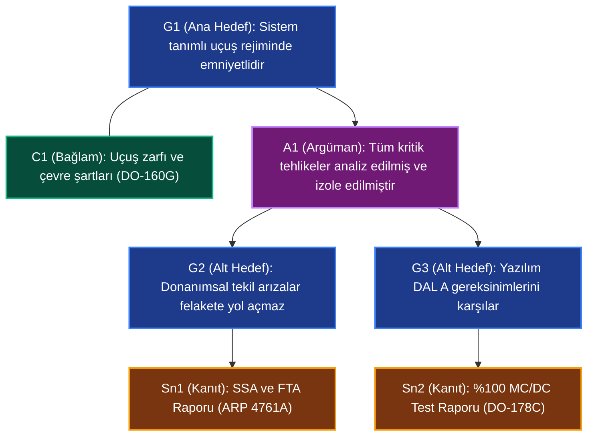

# 📑 Emniyet Vakası (Safety Case) ve Hedef Yapılandırma Notasyonu (GSN)

## 1. Safety Case Nedir?

Bir sistemin belirli bir operasyonel ortamda kabul edilebilir seviyede emniyetli olduğunu iddia eden (**Claim**), bu iddiayı mantıksal argümanlarla savunan (**Argument**) ve somut doğrulama kanıtlarıyla destekleyen (**Evidence**) yapılandırılmış dokümana **Safety Case (Emniyet Dosyası)** denir.

---

## 2. GSN (Goal Structuring Notation) Temel Elemanları

* **Hedef (Goal):** Emniyet ile ilgili doğrulanması gereken iddia.
* **Bağlam (Context):** Hedefin geçerli olduğu operasyonel ortam ve varsayımlar.
* **Argüman (Argument):** Hedefin alt hedeflere nasıl bölündüğünü açıklayan mantıksal kurgu.
* **Kanıt (Solution / Evidence):** Hedefin başarıldığını gösteren test sonuçları, analizler, sertifikalar.
