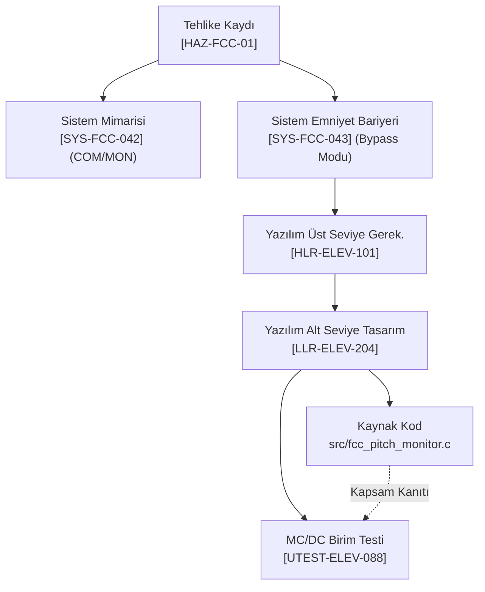

# ✈️ Örnek Vaka İncelemesi: FCC Pitch Runaway Safety Monitor

Bu örnek, havacılık standartlarında (**SAE ARP 4761A**, **ARP 4754B** ve **RTCA DO-178C DAL A**) emniyet-kritik bir yazılım ve sistem koruma bariyerinin nasıl tasarlandığını, kodlandığını ve test edildiğini gösteren somut referans uygulamadır.

---

## 🎯 Fonksiyonel Senaryo ve Tehlike
- **Tehlike:** İrtifa dümeninin (Elevator) istem dışı sürekli maksimum dalış açısına sapması (*Pitch-Down Runaway*).
- **Kritiklik:** **Catastrophic (DAL A / ASIL D)**. İzin verilen maksimum hata olasılığı: $10^{-9}$/uçuş saati.
- **Mimari Çözüm:** Command & Monitor (COM/MON) çift kanallı izleme mimarisi.

---

## 🔗 Çift Yönlü İzlenebilirlik Haritası (Bi-directional Traceability)



---

## 📂 Dosya Yapısı
```text
fcc-pitch-runaway/
├── include/
│   └── fcc_pitch_monitor.h      # MISRA C:2012 Uyumlu Başlık Dosyası
├── src/
│   └── fcc_pitch_monitor.c      # Deterministik C Gerçeklemesi
├── tests/
│   └── test_fcc_pitch_monitor.c # DAL A MC/DC Test Süiti
├── CMakeLists.txt               # Derleme ve Test Yapılandırması
├── sim_pitch_monitor.py         # Python Tabanlı Hızlı Test & Simülatör
└── README.md                    # Bu doküman
```

---

## 🚀 Çalıştırma

### 1. Hızlı Python Simülatörü ve MC/DC Testi:
```bash
python examples/fcc-pitch-runaway/sim_pitch_monitor.py
```

### 2. CMake / C ile Derleme ve Test Koşumu:
```bash
mkdir build && cd build
cmake ..
cmake --build .
ctest --output-on-failure
```
