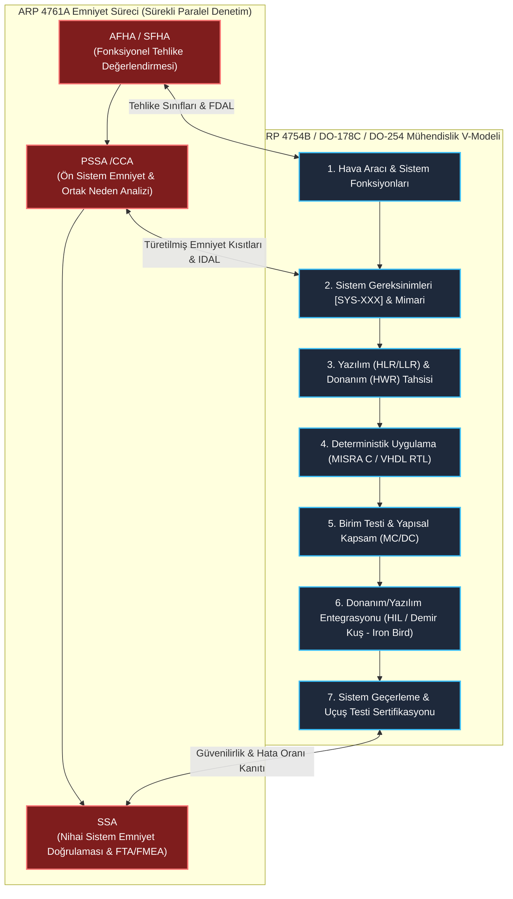

# 📘 Modül 1.1: Emniyet-Kritik Sistem Yaşam Döngüsü, V-Model ve ARP 4754B / 4761A Entegrasyonu

## 1. Giriş: Emniyet-Kritik Sistem Nedir?
Bir sistemin arızalanması, hatalı çalışması veya beklenmeyen bir çevresel koşulla karşılaşması sonucunda **insan ölümü, ağır yaralanma, platformun (uçak, uydu, otonom araç) kaybı veya büyük çaplı çevresel yıkım** meydana geliyorsa bu sisteme **Emniyet-Kritik Sistem (Safety-Critical System)** denir.

Geleneksel ticari yazılımlarda (Web, Mobil, Kurumsal ERP) hatalar yama (*patch*) ile düzeltilebilirken, 35.000 feet irtifada uçan bir Fly-By-Wire uçuş kontrol bilgisayarında veya hipersonik bir savunma sisteminde `NullPointerException` ya da `Stack Overflow` hatasının telafisi yoktur.

---

## 2. Çift Kanatlı Emniyet V-Modeli ve Süreç Eşleşmesi
Emniyet-kritik mühendislik; **Sistem Mühendisliği (ARP 4754B)**, **Emniyet Değerlendirmesi (ARP 4761A)**, **Yazılım (DO-178C)** ve **Donanım (DO-254)** süreçlerinin senkronize bir V-Modeli üzerinde ilerlemesine dayanır:

---

## 3. Doğrulama (Verification) vs. Geçerleme (Validation)
Mühendislik denetimlerinde en sık karıştırılan iki kavram **V&V** ikilisidir:

| Kriter | Doğrulama (Verification) | Geçerleme (Validation) |
| :--- | :--- | :--- |
| **Temel Soru** | *"Ürünü doğru mu inşa ediyoruz?"* (Are we building the product right?) | *"Doğru ürünü mü inşa ediyoruz?"* (Are we building the right product?) |
| **Odak Noktası** | Bir alt katmanın (örn: Kaynak Kod), bir üst katmandaki spesifikasyona (örn: LLR) %100 uyup uymadığı. | Yazılan gereksinimlerin operasyonel ortamda gerçekten emniyetli ve eksiksiz olup olmadığı. |
| **Yöntemler** | İnceleme (Peer Review), Statik Analiz, Birim Testi, MC/DC Kapsamı, İzlenebilirlik (RTM). | Mühendislik Simülatörü, Iron Bird, HIL Testleri, Operatör/Pilot Değerlendirmesi, FHA/PSSA Analizi. |
| **Standart Odağı** | DO-178C ve DO-254 ağırlıklı olarak **Verification** standardıdır (Gereksinimlerin doğru olduğu varsayılır). | ARP 4754B hem gereksinim **Validation** hem de sistem **Verification** süreçlerini zorunlu kılar. |

---

## 4. Yaşam Döngüsü Planlama Belgeleri (5 Ana Plan)
Bir emniyet-kritik projede tek bir satır kod yazılmadan önce sertifikasyon otoritesine (SOI#1 denetimi) şu 5 temel plan sunulur:
1. **PSAC / PHAC:** *Plan for Software/Hardware Aspects of Certification* (Sertifikasyon ana yol haritası).
2. **SDP:** *Software Development Plan* (Gereksinim, tasarım ve kodlama standartlarının nasıl işletileceği).
3. **SVP:** *Software Verification Plan* (İnceleme, test ortamı ve MC/DC kapsam stratejisi).
4. **SCMP:** *Software Configuration Management Plan* (Sürüm kontrolü, baseline, problem raporlama - PR/CR yönetimi).
5. **SQAP:** *Software Quality Assurance Plan* (Bağımsız kalite güvence denetimleri ve uygunluk kayıtları).

---

## 5. İzlenebilirlik Zinciri (Traceability Chain)
Sistemdeki hiçbir gereksinim veya kod parçası sahipsiz (Orphan) olamaz:
- Tehlike Kaydı: `[HAZ-LIFE-01]` Uçuş kontrol yazılımında doğrulanmamış veya izlenemeyen (unintended) fonksiyon bulunması.
- Sistem Gereksinimi: `[SYS-LIFE-010]` Tüm emniyet-kritik alt sistemler ARP 4754B ve DO-178C/DO-254 uyarınca uçtan uca çift yönlü izlenebilirlik matrisine (RTM) sahip olmalıdır.
- Üst Seviye Yazılım Gereksinimi: `[HLR-LIFE-020]` Her kaynak kod fonksiyonu başlığında bağlı olduğu `[LLR-xxx]` ve `[HLR-xxx]` kimliklerini barındırmalıdır.
- Alt Seviye Tasarım: `[LLR-LIFE-030]` CI/CD boru hattı her derlemede `rtm_generator.py` aracını çalıştırarak yetim etiket kontrolü yapmalıdır.
- Doğrulama Testi: `[UTEST-LIFE-040]` Otomatik RTM denetim testi ile %100 izlenebilirlik kapsama doğrulaması.
