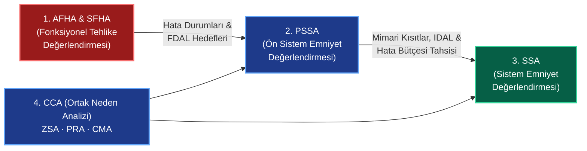

# 📘 Modül 1.2: Fonksiyonel Tehlike Değerlendirmesi (FHA), PSSA, SSA ve CCA (ARP 4761A)

## 1. ARP 4761A Emniyet Değerlendirme Hunisi
**SAE ARP 4761A** (*Guidelines for Conducting the Safety Assessment Process on Civil Aircraft, Systems, and Equipment*), bir hava aracının kavramsal tasarımından tip sertifikasına kadar yürütülen 4 ana emniyet analiz sürecini tanımlar:

---

## 2. FHA (Functional Hazard Assessment) ve Hata Durumu Sınıflandırması
FHA, tasarımın en başında ("Henüz ortada devre şeması veya kod yokken") sorulan şu soruya yanıt verir:
> *"Sistemin yerine getirmesi gereken fonksiyonlar nelerdir ve bu fonksiyonların kaybı (Loss of Function), hatalı çalışması (Malfunction) veya zamansız devreye girmesi (Inadvertent Activation) hangi uçuş fazında neye yol açar?"*

### FAA 14 CFR § 25.1309 / EASA CS-25.1309 Şiddet ve Olasılık Matrisi

| Hata Durumu Şiddeti (Severity) | Nicel Olasılık Sınırı (Uçuş Saati Başına) | Nitel Tanım | Hava Aracı / Sistem Üzerindeki Etkisi | Mürettebat Üzerindeki Etkisi | Atanan DAL |
| :--- | :---: | :--- | :--- | :--- | :---: |
| **Catastrophic (Felaket)** | $< 10^{-9} \text{ / FH}$ | Extremely Improbable | Hava aracının düşmesi, gövde bütünlüğünün kaybı | Çoklu ölüm veya tam kayıp | **DAL A** |
| **Hazardous (Tehlikeli / Ağır)** | $< 10^{-7} \text{ / FH}$ | Extremely Remote | Emniyet marjlarında büyük düşüş, fiziksel stres | Mürettebatın görev yapamaz hale gelmesi veya yolcu ölümü | **DAL B** |
| **Major (Büyük)** | $< 10^{-5} \text{ / FH}$ | Remote | Emniyet marjlarında belirgin azalma | Mürettebat iş yükünde ciddi artış veya yolcu yaralanması | **DAL C** |
| **Minor (Küçük)** | $< 10^{-3} \text{ / FH}$ | Probable | Emniyet marjında hafif azalma | Rutin acil durum prosedürleri | **DAL D** |
| **No Safety Effect** | Kısıt Yok | — | Uçuş emniyetine etkisi yok | İş yükü etkisi yok | **DAL E** |

---

## 3. FHA Analizinde İncelenmesi Gereken 4 Temel Arıza Kip (Failure Modes)
Her bir sistem fonksiyonu (Örn: *Tekerlek Frenleme Fonksiyonu*) için sadece "bozuldu" denmez; en az 4 arıza kipi ayrı ayrı değerlendirilir:
1. **Fonksiyonun Tam Kaybı (Total Loss of Function):** İniş sırasında frenlerin hiç tutmaması (Durum: *Hazardous / Catastrophic*).
2. **Fonksiyonun Kısmi Kaybı / Performans Düşüşü (Partial Loss / Degradation):** Frenleme gücünün %50'ye düşmesi (Durum: *Major*).
3. **İstenmeyen / Zamansız Aktivasyon (Inadvertent / Uncommanded Activation):** Kalkış koşusu ($V_1$ hızı) sırasında pilot frene basmadığı halde frenlerin tam güçle kilitlenmesi (Durum: *Catastrophic — DAL A!*).
4. **Arızanın Gizli Kalması (Annunciated vs. Unannunciated / Latent Failure):** Fren sisteminin havada arızalanması ancak kokpite hiçbir uyarı verilmemesi.

---

## 4. CCA (Common Cause Analysis - Ortak Neden Analizi)
Sisteminizde $10^{-5}$ hata oranına sahip iki bağımsız bilgisayar (Kanal A ve Kanal B) kullandığınızı ve $10^{-5} \times 10^{-5} = 10^{-10} < 10^{-9}$ hedefini tutturduğunuzu düşünebilirsiniz. **Ancak tek bir olay her iki bilgisayarı aynı anda devre dışı bırakırsa yedeklilik sıfırlanır!**

CCA, yedekli kanalların bağımsızlığını üç alt analizle kanıtlar:
1. **ZSA (Zonal Safety Analysis - Bölgesel Emniyet Analizi):** Fiziksel kurulum kontrolü. Kanal A ve Kanal B'nin kabloları uçakta aynı kablo demetinden (harness) mi geçiyor? Aynı hidrolik borunun altında mı duruyor? (Örn: 1989 United Airlines Uçuş 232 kazasında motor diskinin parçalanması 3 bağımsız hidrolik hattını aynı bölgeden geçtiği için aynı anda kesti!).
2. **PRA (Particular Risks Analysis - Özel Riskler Analizi):** Dış veya iç tekil olaylar: Kuş çarpması, lastik patlaması, türbin diski kırılması (Uncontained Rotor Burst), yangın, yüksek yoğunluklu radyasyon alanı (HIRF) ve yıldırım.
3. **CMA (Common Mode Analysis - Ortak Kip Analizi):** Her iki kanalda aynı parti üretimli (Same Lot) kondansatörün, aynı C derleyicisinin veya aynı yazılım algoritmasının kullanılmasından doğan ortak tasarım hatalarının analizi.

---

## 5. İzlenebilirlik Örneği
- Tehlike Kaydı: `[HAZ-FCS-01]` İrtifa (Elevator) kumandasının kilitlenmesi veya kalkış/seyir fazında kontrolsüz burun aşağı/yukarı (Pitch Runaway) komut üretmesi (Şiddet: Catastrophic, Hedef: $< 10^{-9}$/FH, FDAL A).
- Sistem Emniyet Kısıtı (PSSA): `[SYS-FCS-01]` Uçuş kontrol sistemi çift kanallı (Command/Monitor) mimariye ve bağımsız donanımsal ayrıştırma (solenoid bypass) valfine sahip olmalıdır.
- Üst Seviye Yazılım Gereksinimi: `[HLR-FCS-010]` Monitor kanalı, Command kanalı çıktısını bağımsız sensör verisiyle her 10 ms'de karşılaştırmalıdır.
- Alt Seviye Tasarım: `[LLR-FCS-020]` `FCC_EvaluatePitchDiscrepancy()` fonksiyonu 1.5 derece üzerindeki farkı 2 ardışık döngüde tespit ettiğinde bypass pinini sürmelidir.
- Doğrulama Testi: `[HIL-FCS-030]` Hidrolik test rig'inde Command kanalına yapay step arızası enjekte edilerek < 25 ms içinde pasif moda geçişin doğrulanması.
