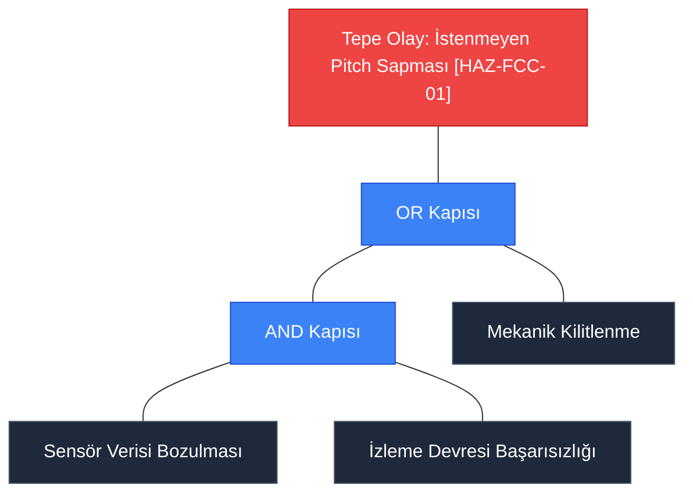
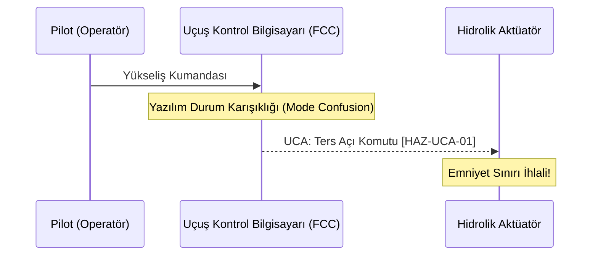

# 📘 Modül 1.3: Klasik ve Modern Emniyet Analizleri (FTA, FMEA & STPA)

## 1. Giriş ve Karşılaştırmalı Yaklaşım
Emniyet değerlendirme süreçlerinde tek bir analiz tekniği yeterli değildir. **ARP 4761A** ve **MIL-STD-882E** uyarınca indüktif (aşağıdan yukarıya) ve dedüktif (yukarıdan aşağıya) analizler birbirini tamamlar. Karmaşık yazılım-insan etkileşimlerinde ise **STAMP/STPA** devreye girer.

---

## 2. FTA (Fault Tree Analysis - Hata Ağacı Analizi)
FTA, istenmeyen bir tepe olayın (Top Event) kök nedenlerini Boolean mantık kapıları (AND, OR, Inhibit, Voting) ile modelleyen dedüktif bir tekniktir.

### Nicel Matematiksel Değerlendirme:
- **AND Kapısı:** Bağımsız bileşenlerin aynı anda arızalanması:
  $$P(AND) = \prod_{i=1}^n P_i$$
- **OR Kapısı:** Bileşenlerden birinin arızalanması:
  $$P(OR) = 1 - \prod_{i=1}^n (1 - P_i) \approx \sum_{i=1}^n P_i \quad (\text{Küçük } P_i \text{ için})$$
- **Minimal Kesme Kümeleri (Minimal Cut Sets - MCS):** Tepe olayın gerçekleşmesi için gereken en küçük bileşen arızaları kombinasyonudur. Tek elemanlı kesme kümesi (Single Point of Failure) DAL A sistemlerde **kesinlikle yasaktır**.

---

## 3. FMEA / FMECA (Failure Modes, Effects, and Criticality Analysis)
FMEA, bileşen seviyesinde başlayan indüktif (aşağıdan yukarıya) bir analizdir.

| Bileşen ID | Hata Modu | Olası Neden | Yerel Etki | Sistem Seviyesi Etkisi | Önleyici Tedbir / Güvenlik Kısıtı |
| :--- | :--- | :--- | :--- | :--- | :--- |
| **`ADC-01`** | Donma (Frozen Output) | Kristal osilatör arızası | Sabit veri üretimi | Pitch monitor devreye girer, yedek kanala geçer | `[SYS-FCC-044]` Veri tazelik sayacı (Alive Counter) kontrolü |
| **`BUS-TX-1`** | Geveze İdiot (Babbling Idiot) | Transceiver kısa devresi | Veri yolunda çakışma | Ağ kilitlenmesi | `[HWR-BUS-012]` Donanımsal Bus Guardian devresi |

---

## 4. Modern Emniyet Devrimi: STPA (System-Theoretic Process Analysis)
Prof. Nancy Leveson (MIT) tarafından geliştirilen **STAMP** modeli, kazaların sadece bileşen arızalarından değil; kontrolsüz etkileşimlerden (interaksiyon hataları, yazılım yetersizliği, insan faktörü) kaynaklandığını savunur.

STPA 4 temel güvensiz kontrol eylemini (**Unsafe Control Actions - UCA**) inceler:
1. Bir kontrol eyleminin **verilmemesi** tehlikeye yol açar.
2. Bir kontrol eyleminin **verilmesi** tehlikeye yol açar.
3. Kontrol eyleminin **çok erken, çok geç veya yanlış sırada** verilmesi.
4. Kontrol eyleminin **çok kısa veya çok uzun süre** uygulanması.

---

## 5. İzlenebilirlik İlişkisi
- Tehlike Tanımı: `[HAZ-FCC-01]` Elevator pitch runaway.
- STPA Eylemi: `[SYS-FCC-043]` COM/MON tutarsızlık izleme ve izolasyon mimarisi.
- Alt Tasarım: `[LLR-ELEV-204]` Ardışık döngü filtrelemesi ile sahte tetiklemelerin engellenmesi.
