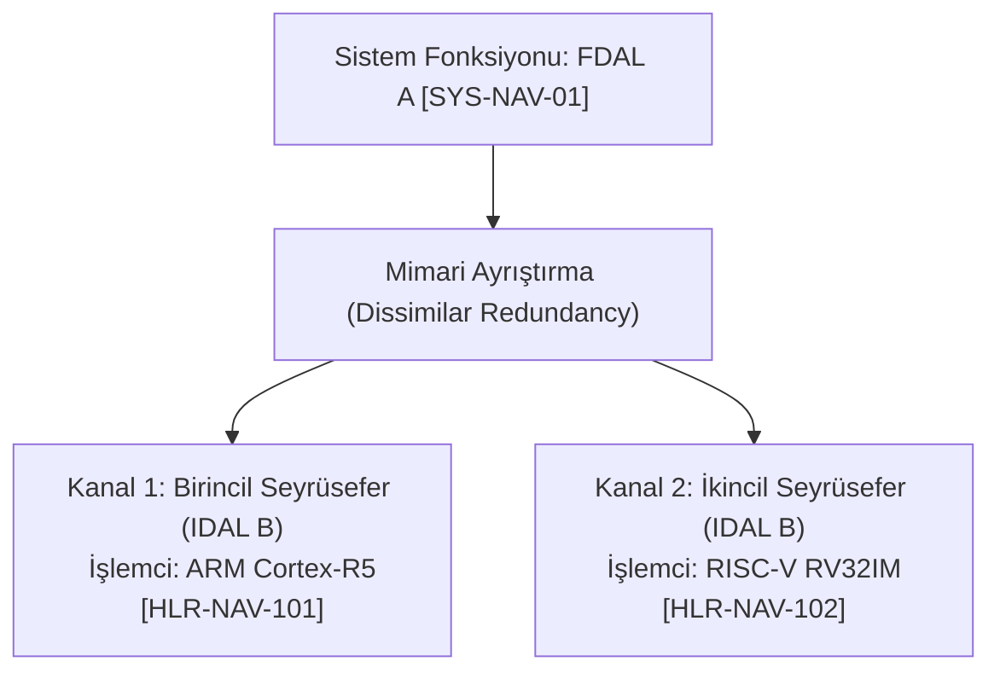

# 📘 Modül 2.1: SAE ARP 4754B Sistem Geliştirme Süreçleri

## 1. ARP 4754B Nedir?
**SAE ARP 4754B** (*Guidelines for Development of Civil Aircraft and Systems*), sivil hava araçları ve sistemlerinin geliştirilmesinde kabul görmüş temel sistem mühendisliği kılavuzudur. FAA (AC 20-174) ve EASA tarafından sistem seviyesinde birincil kabul aracı (Means of Compliance) olarak tanınır.

---

## 2. FDAL ve IDAL Seviyeleri (Tasarım Güvence Seviyeleri)
ARP 4754B, iki tür güvence seviyesi tanımlar:
- **FDAL (Functional Development Assurance Level):** Sistem fonksiyonunun kaybı veya arızasının hava aracı seviyesindeki etkisine göre atanan seviye (A, B, C, D, E).
- **IDAL (Item Development Assurance Level):** Fonksiyonu gerçekleştiren alt bileşenlere (yazılım / donanım) atanan seviye.

### Mimaride Ayrıştırma (Dissimilarity) ve IDAL Düşürme
Eğer bir fonksiyon DAL A kritiklikte ise, tek bir bileşenin arızalanması felakete yol açmamalıdır. Mimari farklılık (Dissimilarity) sağlanarak:
- **1 adet DAL A bileşen yerine;**
- **2 adet bağımsız DAL B bileşen** veya
- **1 adet DAL B + 1 adet DAL D izleme bileşeni** kullanılabilir.

---

## 3. Sistem Gereksinim Süreçleri
ARP 4754B'ye göre gereksinimler 3 temel kategoride ele alınır:
1. **İşlevsel Gereksinimler (Functional Requirements):** Sistemin gerçekleştirmesi gereken davranışlar.
2. **Emniyet Kısıtları (Safety Constraints / Derived Requirements):** FHA/PSSA analizleri sonucu ortaya çıkan ve sistemin asla yapmaması gereken davranışlar.
3. **Arayüz Gereksinimleri (Interface Requirements):** Veri yolu, elektriksel ve mekanik sınırlar.

---

## 4. İzlenebilirlik Zinciri
- Sistem Kök Gereksinimi: `[SYS-FCS-001]` Uçuş kontrol bilgisayarı iki bağımsız güç ve veri hattı üzerinden beslenmelidir.
- Donanım Karşılığı: `[HWR-PWR-010]` Çift izole güç regülatör devresi.
- Yazılım Karşılığı: `[HLR-PWR-005]` Güç durumu izleme ve kanal geçiş algoritması.
