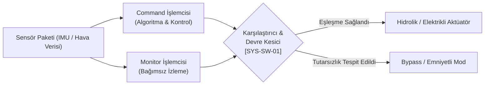

# 📘 Modül 2.2: Emniyet Odaklı Mimari Paternleri & Yedeklilik Mimarileri

## 1. Mimari Felsefesi
Emniyet-kritik sistem tasarımında tekil hata noktası (Single Point of Failure - SPoF) kabul edilemez. Sistemler bir arıza anında insan hayatını koruyacak deterministik bir duruma geçmek zorundadır.

---

## 2. Arıza Davranış Modelleri
1. **Fail-Safe (Hata Durumunda Emniyetli):** Arıza durumunda sistem kendisini güvenli bir duruma (Safe State) geçirir. Örnek: Demiryolu sinyalizasyonunda yeşil ışık bozulursa otomatik kırmızıya dönmesi.
2. **Fail-Operational (Hata Durumunda Çalışmaya Devam Eden):** Bir arıza meydana geldiğinde sistem duramaz, ana fonksiyonlarını sürdürmelidir. Örnek: Otopilot ILS yaklaşması veya Fly-By-Wire uçuş yüzeyleri.
3. **Fail-Passive (Hata Durumunda Nötr/Pasif):** Arıza durumunda sistem istenmeyen hiçbir kumanda üretmez, kendini izole eder.

---

## 3. Donanımsal ve Mantıksal Yedeklilik Paternleri

### A. COM / MON (Command & Monitor) Mimarisi
Uçuş kontrol bilgisayarlarında standart mimaridir.
- **Command Kanalı:** Aktüatöre yönlendirilen komutları üretir.
- **Monitor Kanalı:** Bağımsız sensör veya modelleme ile aynı kumandayı hesaplar.
- İki kanal arasındaki fark belirlenen eşik değerini ve tolerans süresini aşarsa aktüatör bypass edilir.

### B. TMR (Triple Modular Redundancy - Üçlü Modüler Yedeklilik)
Üç özdeş veya farklı kanaldan gelen çıktılar bir çoğunluk oylayıcıya (Majority Voter) girer. Bir kanalda arıza olsa dahi kesinti olmadan operasyon sürer:
$$\text{Output} = (A \land B) \lor (B \land C) \lor (A \land C)$$

### C. Farklılık (Dissimilarity / Diversity)
Aynı donanım veya yazılım parçasının ortak bir tasarım hatası nedeniyle aynı anda çökmesini (Common Cause Failure - CCF) engellemek için:
- **Farklı İşlemciler:** Kanal A ARM mimarisinde, Kanal B x86 veya RISC-V mimarisinde çalışır.
- **Farklı Yazılım Dilleri & Ekipleri:** Biri MISRA C ile yazılırken diğeri SPARK Ada ile bağımsız geliştirilir.

---

## 4. Sistem Gereksinim Örneği
* `[SYS-ARCH-101]`: Uçuş kontrol bilgisayarı COM/MON mimarisinde çalışacak, iki kanal arasındaki tutarsızlık 2 ardışık döngüden (20 ms) uzun sürerse sistem Fail-Passive durumuna geçecektir.
* `[HLR-ARCH-101]`: `mon_discrepancy_check` görevi her 10 ms'de çalışacak ve arıza bayrağını güncelleyecektir.
