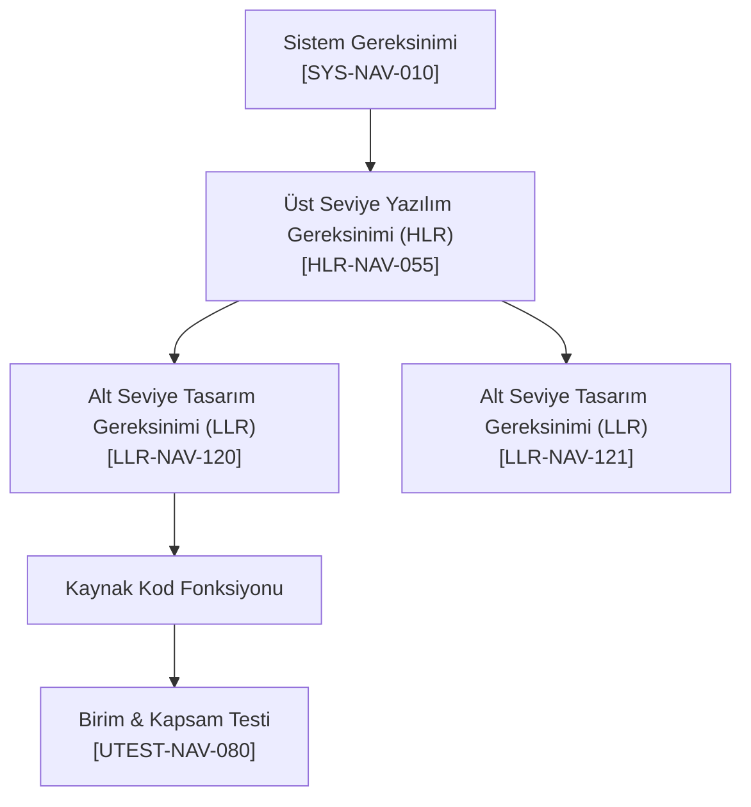

# 📘 Modül 3.2: Yazılım Gereksinim Hiyerarşisi (HLR, LLR & Türetilmiş Gereksinimler)

## 1. Yazılım Gereksinim Katmanları
DO-178C uyarınca yazılım geliştirme doğrudan kaynak kodla başlamaz. İki katmanlı bir ayrıştırma zorunludur:

---

## 2. HLR vs. LLR Karşılaştırması

### A. Üst Seviye Yazılım Gereksinimleri (HLR - High-Level Requirements)
- Sistem gereksinimlerinden doğrudan türetilir.
- Yazılımın "NE" yapacağını açıklar, "NASIL" yapacağına (hangi algoritma, hangi veri yapısı) odaklanmaz.
- Örnek: `[HLR-NAV-055]` Uçuş bilgisayarı, GPS sinyali kaybolduğunda 100 ms içinde INS (Inertial Navigation System) moduna geçecektir.

### B. Alt Seviye Tasarım Gereksinimleri (LLR - Low-Level Requirements)
- HLR'ların yazılım mimarisi ve algoritma düzeyine indirilmiş halidir.
- Bir yazılımcı LLR'a bakarak başka hiçbir açıklamaya ihtiyaç duymadan kaynak kodu doğrudan yazabilmelidir.
- Örnek: `[LLR-NAV-120]` `Nav_CheckSignalStatus()` fonksiyonu, `gps_valid_pin` LOW ise ve `last_sample_tick > 10` ise `active_mode = INS_MODE` ataması yapmalıdır.

---

## 3. Türetilmiş Gereksinimler (Derived Requirements) ve Emniyet Bildirimi
Eğer bir HLR veya LLR, doğrudan bir üst seviye sistem gereksiniminden gelmiyorsa; geliştirme sürecinde mimari bir zorunluluk olarak ortaya çıkmışsa buna **Türetilmiş Gereksinim (Derived Requirement)** denir.

> ⚠️ **DO-178C Kuralı:** Tüm türetilmiş gereksinimler, hava aracının veya sistemin emniyet değerlendirme sürecine (**Safety Assessment Process - ARP 4761A**) geri bildirilmeli ve sistem emniyet mühendisi tarafından risk oluşturmadığı onaylanmalıdır.
