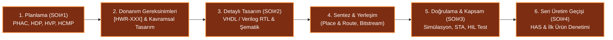

# 📘 Modül 4.1: RTCA DO-254 Karmaşık Elektronik Donanım (CEH) Tasarım Güvencesi

## 1. DO-254 Nedir ve Neden İhtiyaç Duyulmuştur?
**RTCA DO-254 / EUROCAE ED-80** (*Design Assurance Guidance for Airborne Electronic Hardware*), sivil ve askeri hava araçlarındaki karmaşık elektronik donanımların uçuşa elverişlilik sertifikasyonu için temel standarttır (FAA AC 20-152A ve EASA AMC 20-152A ile zorunlu kılınmıştır).

Geçmişte donanımlar ayrık (discrete) direnç, kondansatör ve basit analog devrelerden oluşurken; günümüzde uçuş kontrol ve motor kontrol kartlarında milyonlarca lojik kapı içeren **FPGA (Field Programmable Gate Array)**, **ASIC (Application-Specific Integrated Circuit)** ve **CPLD** yongaları kullanılmaktadır. VHDL, Verilog veya SystemVerilog ile tasarlanan bir FPGA, geleneksel testlerle tüm iç durumları ($2^N$ durum uzayı) test edilemeyecek kadar karmaşıktır.

---

## 2. DO-254 Donanım Sınıflandırması: Basit vs. Karmaşık (Simple vs. Complex)
FAA AC 20-152A uyarınca bir elektronik bileşen (COTS mikroişlemci, FPGA veya devre kartı) iki sınıfa ayrılır:
- **Basit Donanım (Simple Electronic Hardware):** Tüm olası girdi ve iç durum kombinasyonlarının deterministik testlerle %100 kapsanabildiği, gizli durum makinesi içermeyen donanımlardır.
- **Karmaşık Elektronik Donanım (CEH - Complex Electronic Hardware):** İç durumları sadece dış pin testleriyle tamamen gözlemlenemeyen tüm FPGA, ASIC, SoC ve çok çekirdekli işlemcilerdir.

---

## 3. DO-254 Donanım Tasarım Yaşam Döngüsü ve SOI Denetimleri



---

## 4. DAL A ve DAL B İçin İleri Doğrulama (Appendix B - Advanced Verification)
DO-254 Ek B (Appendix B), **DAL A ve DAL B** seviyesindeki FPGA/ASIC tasarımları için standart fonksiyonel testlerin ötesinde ek mühendislik kanıtları şart koşar:

| Doğrulama Alanı | Teknik Gereklilik | Mühendislik Amacı |
| :--- | :--- | :--- |
| **Elemental Analysis (EA - Eleman Analizi)** | RTL Kod Kapsamı: Statement, Branch, Condition, Expression, **Toggle Coverage** ve **FSM State/Transition Coverage** (%100 hedef). | Sentezlenen RTL kodunda ölü lojik kapı, hiç tetiklenmeyen bit veya ulaşılamaz durum makinesi kalmadığını kanıtlamak. |
| **Static Timing Analysis (STA)** | En kötü sıcaklık (-55°C / +125°C), en düşük voltaj ve üretim prosesi (PVT Corners) altında Setup & Hold zamanlama analizi. | Saat frekansında (Clock) hiçbir flip-flop'un yarı-kararlı (**Metastability**) duruma düşmeyeceğini matematiksel olarak kanıtlamak. |
| **Clock Domain Crossing (CDC)** | Farklı saat kaynakları (Asenkron saat alanları) arasındaki sinyallerin çift flip-flop senkronizör veya asenkron FIFO ile korunması. | Asenkron saat geçişlerinde veri bozulması (Glitch / Data Incoherency) yaşanmasını önlemek. |
| **Safe State Machines (Emniyetli FSM)** | VHDL/Verilog durum makinelerinde `when others => state <= SAFE_RESET;` tanımı ve **Hamming Distance $\ge 3$ (SECDED)** veya One-Hot kodlama. | Radyasyon (SEU) nedeniyle durum yazmacındaki bir bit devrilirse, FSM'nin tanımsız bir durumda kilitlenip kalmamasını (Deadlock) sağlamak. |

---

## 5. Savunmacı VHDL RTL Tasarım Örneği (DO-254 DAL A Uyumlu)

```vhdl
-- ============================================================================
-- Traceability: [HWR-FPGA-01] <- [SYS-FCC-043]
-- Description : DO-254 DAL A Safe Finite State Machine with Fault Recovery
-- ============================================================================
library IEEE;
use IEEE.STD_LOGIC_1164.ALL;

entity Safe_Actuator_Guard is
    Port (
        clk_10mhz     : in  std_logic;
        rst_n         : in  std_logic;
        dcm_locked    : in  std_logic;
        com_mon_fault : in  std_logic;
        valve_enable  : out std_logic;
        fault_latched : out std_logic
    );
end Safe_Actuator_Guard;

architecture RTL of Safe_Actuator_Guard is
    type state_type is (ST_RESET, ST_ARMED, ST_TRIPPED_SAFE);
    signal current_state : state_type := ST_RESET;

    -- Sentez aracının "when others" kurtarma mantığını optimize edip silmesini engelle:
    attribute fsm_safe_state : string;
    attribute fsm_safe_state of current_state : signal is "ST_TRIPPED_SAFE";
begin
    process(clk_10mhz, rst_n)
    begin
        if (rst_n = '0') then
            current_state <= ST_RESET;
            valve_enable  <= '0';
            fault_latched <= '0';
        elsif rising_edge(clk_10mhz) then
            if (dcm_locked = '0') then
                -- [HWR-FPGA-01] Saat kilitli değilse güvenli durumda kal
                current_state <= ST_RESET;
                valve_enable  <= '0';
            else
                case current_state is
                    when ST_RESET =>
                        if (com_mon_fault = '0') then
                            current_state <= ST_ARMED;
                            valve_enable  <= '1';
                        end if;

                    when ST_ARMED =>
                        if (com_mon_fault = '1') then
                            current_state <= ST_TRIPPED_SAFE;
                            valve_enable  <= '0';
                            fault_latched <= '1';
                        else
                            valve_enable  <= '1';
                        end if;

                    when ST_TRIPPED_SAFE =>
                        -- Latched Safe State: Güç kesilene kadar aktüatör kapalı kalır
                        valve_enable  <= '0';
                        fault_latched <= '1';

                    when others =>
                        -- SEU kaynaklı yasadışı durum (Illegal State) yakalama
                        current_state <= ST_TRIPPED_SAFE;
                        valve_enable  <= '0';
                        fault_latched <= '1';
                end case;
            end if;
        end if;
    end process;
end RTL;
```

---

## 6. İzlenebilirlik Örneği
- Sistem Gereksinimi: `[SYS-FCC-043]` Uçuş kontrol kartı, işlemci yazılımından bağımsız olarak COM/MON hata sinyali geldiğinde hidrolik valf enerjisini donanımsal olarak kesmelidir.
- Donanım Gereksinimi: `[HWR-FPGA-01]` FPGA, 10 MHz senkron saat frekansında çalışmalı, DCM kilitlenene kadar reset durumunu korumalı ve `com_mon_fault` sinyali aktif olduğunda 1 saat darbesi (100 ns) içinde `valve_enable` çıkışını lojik `'0'` seviyesinde kilitlemelidir.
- Donanım Doğrulama Testi: `[HIL-FPGA-01]` Osiloskop ve lojik analizör ile başlatma sinyalinin, saat kaybı davranışının ve 100 ns kesme tepki süresinin hedef kart üzerinde doğrulanması.
