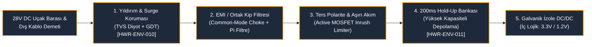

# 📘 Modül 4.3: RTCA DO-160G / MIL-STD-810H Çevresel Dayanım ve EMI/EMC Kalifikasyonu

## 1. RTCA DO-160G / EUROCAE ED-14G Nedir?
Laboratuvarda masa üzerinde kusursuz çalışan bir aviyonik bilgisayar; **-55°C dondurucu soğukta, 55.000 ft vakum altında, jet motoru titreşiminde veya uçağa yıldırım düştüğü anda** reset atıyor ya da yanlış sensör verisi okuyorsa uçuşa elverişli değildir.

**RTCA DO-160G** (Savunma sanayiinde **MIL-STD-810H** ve **MIL-STD-461G**), hava aracı ekipmanlarının maruz kalacağı tüm fiziksel ve elektromanyetik çevre koşullarını 26 bölüm (Section) halinde standartlaştıran kalifikasyon kılavuzudur.

---

## 2. DO-160G Temel Test Bölümleri ve Mühendislik Kriterleri

| Bölüm | Test Başlığı | Fiziksel Zorluk & Test Profili | Tipik Donanım Arızası | Tasarım Önlemi (Mitigation) |
| :---: | :--- | :--- | :--- | :--- |
| **Sec 4** | Sıcaklık ve İrtifa | -55°C ila +70°C/+85°C; 55.000 ft düşük basınç ve ani basınç kaybı (Rapid Decompression) | Elektrolitik kapasitör patlaması, soğukta osilatör frekans kayması, azalan hava yoğunluğuyla soğutma kaybı | Katı hal seramik/tantal kapasitör, iletimle soğutma (Conduction Cooling - kama kilit) |
| **Sec 5** | Termal Şok (Temperature Variation) | Dakikada $\ge 10^\circ\text{C}$ hızla ekstrem sıcak-soğuk döngüleri | Farklı ısıl genleşme katsayısı (CTE) nedeniyle BGA lehim toplarının kırılması | Yüksek $T_g$ (Camlaşma sıcaklığı) PCB malzemesi ve BGA köşe epoksi dolgusu (Underfill) |
| **Sec 6** | Nem (Humidity) | %95 bağıl nemde günlerce yoğuşmalı maruziyet | PCB yolları arasında elektrokimyasal göç (Dendrite büyümesi) ve kısa devre | PCB yüzeyine **Conformal Coating** (Akrilik/Parylene koruyucu kaplama) |
| **Sec 7** | Operasyonel Şok & Çarpışma Emniyeti | 6G operasyonel şok; 20G darbe dayanımı (Crash Safety) | Ağır indüktörlerin/konnektörlerin PCB'den kopması, şasinin kırılması | Mekanik sabitleme, MIL-DTL-38999 vidalı/kilitli havacılık konnektörleri |
| **Sec 8** | Titreşim (Vibration) | Sinüzoidal ve Rastgele (Random) titreşim (10 Hz – 2000 Hz) | Kartın doğal rezonans frekansına ($f_n$) girerek yüksek genlikle esnemesi ve çatlaması | Şasi nervürleri (Stiffener) ile kartın ilk doğal frekansını $> 200\text{ Hz}$ üzerine taşımak |
| **Sec 16** | Güç Girişi (Power Input - 28V DC) | Normal (22-29V), Anormal (18V çökme / 80V surge) ve **200 ms Güç Kesintisi (Hold-up)** | Geçici voltaj kesintisinde uçuş bilgisayarının kapanıp yeniden başlaması (Reboot) | Girişte **Hold-up Kapasitör Bankası** ile 200 ms boyunca kesintisiz enerji sağlama |
| **Sec 20** | HIRF (Radyo Frekans Duyarlılığı) | Radarların yanından geçerken 100 V/m – 3000 V/m elektromanyetik alan | Analog sensör hatlarında sahte gerilim indüklenmesi, işlemci saat bozulması | Faraday kafesi metal şasi, 360° ekranlı konnektör backshell, EMI filtreli feedthrough |
| **Sec 22** | Yıldırım Dolaylı Etkileri (Lightning) | Dalga formları (Waveform 3, 4, 5A): Kablolarda 600V – 3000V ve yüzlerce Amper darbe | Transceiver (ARINC 429 / CAN) ve güç katı yarı iletkenlerinin anında yanması | **TVS Diyotları**, Gaz Deşarj Tüpleri (GDT), Galvanik İzolasyon (Optokuplör / Trafo) |

---

## 3. Aviyonik Güç Katı ve Yıldırım / EMI Koruma Mimarisi

DO-160G Bölüm 16, 17, 19, 20 ve 22'yi aynı anda geçebilmek için her aviyonik LRU (Line Replaceable Unit) girişinde çok kademeli bir koruma zinciri tasarlanır:

---

## 4. İzlenebilirlik Zinciri
- Tehlike Kaydı: `[HAZ-ENV-01]` Hava aracına yıldırım isabet etmesi veya 28V DC güç barasındaki anlık kesinti nedeniyle uçuş kontrol bilgisayarının (FCC) eşzamanlı olarak devre dışı kalması.
- Sistem Gereksinimi: `[SYS-ENV-100]` Uçuş kontrol bilgisayarı RTCA DO-160G Bölüm 16 (Kategori A/Z - 200 ms güç kesintisi) ve Bölüm 22 (Kategori A3J3L3 - Yıldırım dolaylı etkileri) altında performans kaybı veya reset olmaksızın çalışmaya devam etmelidir.
- Donanım Gereksinimi 1: `[HWR-ENV-010]` Tüm harici veri ve güç pinlerinde DO-160G Bölüm 22 Seviye 3 darbesini $< 40\text{ V}$ seviyesine kırpan çift yönlü TVS diyot dizisi bulunmalıdır.
- Donanım Gereksinimi 2: `[HWR-ENV-011]` Güç katı hold-up kapasitör bankası ($C = \frac{2 \cdot P \cdot \Delta t}{V_{in}^2 - V_{min}^2}$), 28V giriş kesildiğinde sistemi en az 200 ms boyunca besleyebilecek enerjiyi depolamalıdır.
- Doğrulama Testi: `[HIL-ENV-020]` Kalifikasyon laboratuvarında DO-160G Bölüm 22 dalga formu jeneratörü ile pin enjeksiyonu ve 200 ms güç kesme testi.
