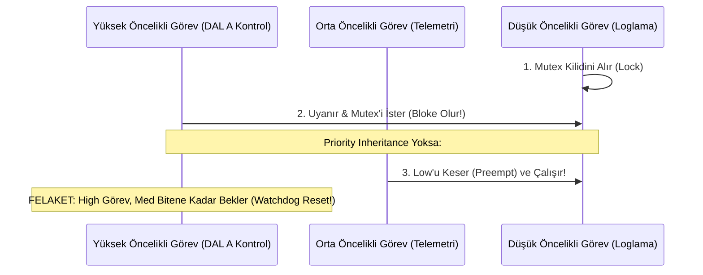

# 📘 Modül 5.1: Gerçek Zamanlı Sistemler, Determinizm, WCET ve Zamanlama Teorisi

## 1. Hard Real-Time vs. Soft Real-Time: Zamanlamanın Doğruluk Tanımı
Geleneksel bilişimde bir algoritmanın doğruluğu yalnızca ürettiği matematiksel sonuca bağlıdır. **Gerçek Zamanlı (Real-Time)** sistemlerde ise:
> *"Sistemin doğruluğu yalnızca üretilen mantıksal sonuca değil; o sonucun üretildiği **fiziksel zamana** da bağlıdır. Son teslim tarihinden (Deadline) sonra üretilen doğru bir cevap, **yanlış (ve ölümcül) bir cevaptır**."*

| Özellik | Soft Real-Time (Yumuşak Gerçek Zamanlı) | Firm Real-Time (Sıkı Gerçek Zamanlı) | Hard Real-Time (Katı Gerçek Zamanlı) |
| :--- | :--- | :--- | :--- |
| **Deadline İhlali Sonucu** | Hizmet kalitesi düşer (Örn: Videoda kare atlama) | Geciken veri işe yaramaz ve atılır ama sistem çökmez | **Felaket (Catastrophic):** Uçağın kontrol kaybı, hava yastığının geç açılması |
| **Kabul Edilebilir İhlal Oranı** | İstatistiksel ortalama (%99) | Çok nadir | **Sıfır (%100 Deterministik Garanti)** |
| **Tasarım Hedefi** | Yüksek Ortalama Performans (Throughput) | Düşük Gecikme | **Garantili En Kötü Durum (WCET < Deadline)** |

---

## 2. Görev Zamanlama Anatomisi: WCET, BCET ve Jitter

Bir periyodik kontrol görevinin (Task $\tau_i$) zaman eksenindeki davranışı şu parametrelerle tanımlanır:
- **$T_i$ (Period):** Görevin tetiklenme periyodu (Örn: $10\text{ ms} = 100\text{ Hz}$).
- **$C_i$ (WCET - Worst-Case Execution Time):** Görevin en kötü girdi, en soğuk önbellek (Cache Miss) ve en yoğun veri yolu altında tamamlanması için gereken **maksimum işlemci süresi**.
- **$D_i$ (Relative Deadline):** Görevin tamamlanması gereken son an (Genellikle $D_i \le T_i$).
- **$R_i$ (Worst-Case Response Time):** Görevin serbest kalmasından (Release) yüksek öncelikli görevlerin kesmeleri dahil tamamlanmasına kadar geçen en uzun süre ($R_i \le D_i$ olmak zorundadır).
- **$J_i$ (Jitter - Zaman Salınımı):** Görevin başlama veya dış aktüatöre çıktı verme anındaki zamansal sapma ($R_{max} - R_{min}$). Dijital kontrol döngülerinde (PID / LQR) yüksek jitter doğrudan **faz marjı kaybına (Phase Margin Degradation)** ve kararsız salınıma yol açar.

### Çok Çekirdekli (Multi-Core) İşlemcilerde WCET Zorluğu (CAST-32A / AMC 20-193)
Modern çok çekirdekli işlemcilerde (ARM Cortex-A/R, PowerPC, AURIX) Çekirdek 0 ve Çekirdek 1 aynı **L2/L3 Önbelleği (Cache)**, aynı **DDR RAM denetleyicisini** ve aynı **Dahili Veri Yolunu (Interconnect)** paylaşır. Çekirdek 1 yoğun bellek erişimi yaptığında Çekirdek 0'ın WCET süresi **3 ila 10 kat** uzayabilir!  
**CAST-32A / EASA AMC 20-193** uyarınca DAL A/B sistemlerde bu **Girişim Kanalları (Interference Channels)** ölçülmeli, önbellek bölümlendirilmeli (Cache Coloring/Locking) veya bellek bant genişliği sınırlandırılmalıdır.

---

## 3. Zamanlama Algoritmaları ve Matematiksel Zamanlanabilirlik (Schedulability)

### A. Rate Monotonic Scheduling (RMS - Liu & Layland Teoremi, 1973)
Statik öncelikli (Fixed-Priority Preemptive) zamanlamadır: **Periyodu ($T_i$) en kısa olan göreve en yüksek öncelik verilir.**
$n$ adet bağımsız görev için toplam işlemci kullanım oranı (CPU Utilization $U$) sınırı:
$$U = \sum_{i=1}^{n} \frac{C_i}{T_i} \le n \left(2^{1/n} - 1\right)$$
- $n = 1 \implies U \le 100\%$
- $n = 2 \implies U \le 82.8\%$
- $n = 3 \implies U \le 77.9\%$
- $n \to \infty \implies \lim_{n \to \infty} n(2^{1/n}-1) = \ln(2) \approx \mathbf{69.3\%}$

> **Mühendislik Kuralı:** Eğer görevlerin toplam CPU kullanımı %69.3'ün altındaysa, RMS altında **hiçbir görevin deadline kaçırmayacağı matematiksel olarak garantidir!**

### B. Zaman Tetiklemeli Döngüsel Yürütücü (Time-Triggered Cyclic Executive)
DAL A uçuş kontrol sistemlerinde kesme fırtınası (Interrupt Storm) riskinden kaçınmak için görevler dinamik öncelikle değil, statik bir **Major Frame / Minor Frame** tablosuyla koşturulur.

---

## 4. Öncelik Tersinmesi (Priority Inversion) — Mars Pathfinder Vakası (1997)
1997 yılında Mars yüzeyine inen NASA **Mars Pathfinder** uzay aracı, inişten kısa süre sonra sürekli kendi kendini resetlemeye başladı.
- **Kök Neden:** Düşük öncelikli bir meteoroloji görevi ($\tau_{low}$), paylaşılan veri yolu Mutex kilidini aldı. Bu sırada yüksek öncelikli veri yolu yönetim görevi ($\tau_{high}$) uyandı ve kilidi beklemeye başladı. Tam o anda kilitle hiç ilgisi olmayan orta öncelikli iletişim görevi ($\tau_{med}$) devreye girip $\tau_{low}$'un çalışmasını engelledi! Sonuçta orta öncelikli görev, dolaylı olarak en yüksek öncelikli görevi kilitledi (**Unbounded Priority Inversion**).

### Çözüm Protokolleri:
1. **Priority Inheritance Protocol (PIP - Öncelik Mirası):** $\tau_{high}$, $\tau_{low}$'un tuttuğu kilidi beklemeye başladığı anda işletim sistemi $\tau_{low}$'un önceliğini geçici olarak $\tau_{high}$ seviyesine yükseltir.
2. **Priority Ceiling Protocol (PCP / Immediate Priority Ceiling - OSEK / AUTOSAR OS & Ada Ravenscar):** Her kaynağa (Mutex) o kaynağı kullanabilecek en yüksek öncelikli görevin tavan önceliği atanır. Kilidi alan görev anında o tavan önceliğe çıkar; böylece hem **Priority Inversion** hem de **Deadlock (Ölümcül Kilitlenme)** matematiksel olarak imkansız hale gelir!

---

## 5. İzlenebilirlik Zinciri
- Tehlike Kaydı: `[HAZ-RTOS-01]` Uçuş kontrol döngüsü görevinin öncelik tersinmesi veya WCET aşımı nedeniyle 10 ms deadline sınırını kaçırması ve faz gecikmesi kaynaklı uçak kararsızlığı.
- Sistem Gereksinimi: `[SYS-RTOS-100]` İşletim sistemi zamanlayıcısı %70 maksimum CPU kullanım sınırını aşmamalı ve paylaşılan kaynaklarda Immediate Priority Ceiling Protocol (PCP) kullanmalıdır.
- Üst Seviye Yazılım Gereksinimi: `[HLR-RTOS-110]` 100 Hz birincil uçuş kontrol görevinin (`Task_FlightControl_10ms`) hedef işlemci üzerindeki en kötü durum icra süresi (WCET) $3.5\text{ ms}$'yi aşmamalıdır.
- Alt Seviye Tasarım: `[LLR-RTOS-120]` Zamanlayıcı döngüsü sonunda donanımsal zaman damgası sayacı okunmalı, görev süresi $3500\ \mu\text{s}$'yi aşarsa `WCET_OVERRUN_WARN` bayrağı kaydedilmelidir.
- Doğrulama Testi: `[HIL-RTOS-130]` Statik WCET analiz aracı (AbsInt aiT) ve donanım GPIO lojik analizör darbe ölçümü ile 10.000 ardışık döngüde maksimum icra süresinin $< 3.5\text{ ms}$ olduğunun doğrulanması.
