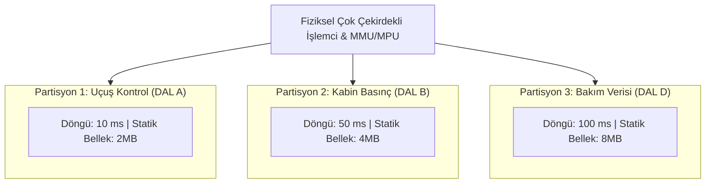

# 📘 Modül 5.2: ARINC 653 Standardı ve IMA (Integrated Modular Avionics)

## 1. Klasik Federatif Mimari vs. IMA Mimarisi
Eski uçaklarda (Federated Architecture) her fonksiyon için ayrı bir "Kara Kutu" (LRU - Line Replaceable Unit) bulunurdu. Bu durum ağırlık, kablolama ve yüksek maliyet yaratıyordu.

**IMA (Entegre Modüler Aviyonik):** Farklı kritiklik seviyelerine (DAL A, DAL B, DAL C) sahip birden çok yazılım uygulamasının **tek bir ortak işlemci ve bellek donanımı** üzerinde emniyetle çalıştırılmasıdır.

---

## 2. ARINC 653 İzolasyon (Robust Partitioning) Prensipleri
Bir ARINC 653 işletim sistemi (VxWorks 653, PikeOS, Integrity-178), iki katı izolasyon garantisi verir:

### A. Uzamsal Ayrıştırma (Spatial Partitioning)
- Her partisyona donanımsal MPU/MMU ile ayrılmış bağımsız fiziksel adres alanı tahsis edilir.
- Partisyon 3'te meydana gelen bir bellek taşması (Memory corruption veya NULL pointer erişimi), Partisyon 1'in belleğine kesinlikle dokunamaz.

### B. Zamansal Ayrıştırma (Temporal Partitioning)
- Statik zamanlama: İşlemci süresi **Major Frame** ve **Minor Frame** dilimlerine bölünür.
- Partisyon 3 sonsuz döngüye girse dahi, zaman dilimi bittiğinde donanımsal zamanlayıcı kesmesiyle CPU elinden alınır ve Partisyon 1 zamanında başlar.

---

## 3. ARINC 653 İletişim Portları
Partisyonlar arası haberleşme güvenli APEX (Application Executive) API'leri ile yapılır:
1. **Sampling Port (Örnekleme Portu):** En son gelen veri eskisinin üzerine yazar. Sensör verileri için kullanılır.
2. **Queuing Port (Kuyruk Portu):** FIFO kuyruk yapısıdır. Mesaj kaybolmadan sırayla okunur. Komut veya durum iletimi için kullanılır.
