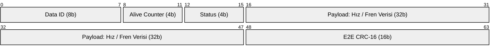

# 📘 Modül 6.2: Otomotiv ve Deterministik Ağlar (CAN, FlexRay & E2E Güvenliği)

## 1. CAN (Controller Area Network) ve Emniyet Kısıtları
CAN veri yolu otomotivde yaygın olarak kullanılır ancak saf haliyle ISO 26262 ASIL D gereksinimlerini tek başına karşılayamaz:
- **Sorun:** Mesajlar önceliğe göre hattan akar (Arbitration), ancak düşük öncelikli mesajlar yüksek trafik anında gecikebilir (Starvation).
- **Hata Modları:** Tekrarlanan mesajlar, kaybolan mesajlar, gecikmiş mesajlar, bozulmuş veri.

---

## 2. AUTOSAR E2E (End-to-End) Koruma Profilleri
ASIL sertifikasyonunu sağlamak için CAN paketinin veri payload'ı içine uygulama seviyesinde emniyet başlıkları eklenir:
1. **CRC (Cyclic Redundancy Check):** İletim bozulmalarına karşı sağlama toplamı.
2. **Alive Counter (Sıralı Sayaç):** Mesajın kaybolduğunu veya donduğunu (frozen sensor) anlamak için her pakette 1 artan sayaç.
3. **Data ID:** Mesajın yanlış bir alıcıya ait olmadığını doğrulayan benzersiz kimlik.

---

## 3. "Babbling Idiot" Problemi ve Bus Guardian
Bir kontrol ünitesi (ECU) arızalanıp veri yoluna sürekli anlamsız paketler basarsa (Babbling Idiot), tüm ağ bloke olabilir.
- **Bus Guardian:** Fiziksel katmanda yer alan ve her düğümün sadece kendisine ayrılan statik zaman diliminde veri göndermesine izin veren bağımsız donanımsal bekçidir.
