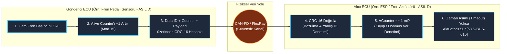

# 📘 Modül 6.2: Otomotiv ve Deterministik Ağlar (CAN-FD, FlexRay, TSN & AUTOSAR E2E)

## 1. CAN / CAN-FD (Controller Area Network) ve Emniyet Kısıtları
CAN (ISO 11898), diferansiyel iki telli (`CAN_H` ve `CAN_L`) fiziksel katmanı sayesinde elektromanyetik gürültüye çok dayanıklıdır ve otomotivden İHA/SİHA alt sistemlerine (DroneCAN / UAVCAN) kadar geniş bir kullanım alanına sahiptir.

Ancak **saf CAN protokolü tek başına ISO 26262 ASIL D veya DO-178C DAL A iletişim emniyetini sağlayamaz**:
- **Olay Tetiklemeli Arbitrasyon (CSMA/CR):** İki düğüm aynı anda konuşursa, Mesaj ID'si sayısal olarak daha küçük olan (dominant `0` biti) hattı kazanır. Ancak yüksek öncelikli mesajlar hattı doldurursa düşük öncelikli mesajlar belirsiz süre gecikebilir (**Priority Starvation**).
- **Veri Yolu Hata Modları (ISO 26262-6 / IEC 61508):**
  1. Veri Bozulması (*Corruption*)
  2. Mesaj Kaybı (*Loss of Message*)
  3. Mesaj Gecikmesi / Zamansız Varış (*Unacceptable Delay / Jitter*)
  4. Mesaj Tekrarı (*Repetition / Replay*)
  5. Yanlış Sıralama veya Sahte Ekleme (*Incorrect Sequence / Masquerading*)

---

## 2. AUTOSAR E2E (End-to-End) Koruma Profilleri
Fiziksel veri yolu (CAN, FlexRay, Ethernet) ne kadar gürültülü veya karmaşık olursa olsun, **Uygulama Katmanından Uygulama Katmanına (SW-C to SW-C)** verinin bütünlüğünü ve tazeliğini kanıtlamak için **AUTOSAR E2E Library** kullanılır.

### AUTOSAR E2E Paket Başlığı (Bit Düzeyi Yerleşim)
```text
Bit 0          Bit 7 Bit 8         Bit 11 Bit 12   Bit 15 Bit 16                   Bit 47 Bit 48        Bit 63
+-------------------+--------------------+---------------+-------------------------------+-------------------+
|   Data ID (8b)    | Alive Counter (4b) |  Status (4b)  |  Uygulama Verisi: Tork / Fren |  E2E CRC-16 (16b) |
| (Gizli/Açık Kimlik)| (0..14 Döngüsel)   | (Sensör Durum)|         (32-bit Payload)      | (Polinom: 0x1021) |
+-------------------+--------------------+---------------+-------------------------------+-------------------+
```



### E2E Koruma Mekanizmalarının Yakaladığı Hatalar:
1. **CRC (Cyclic Redundancy Check - CRC-8 / CRC-16 / CRC-32P4):** İletim sırasında donanım tamponlarında (Buffer) veya kabloda oluşan çok bitli bozulmaları yakalar.
2. **Alive Counter / Sequence Counter:** Her gönderimde `1` artar. Alıcı tarafında sayaç değişmemişse ($\Delta = 0$) gönderici yazılımın donduğu (**Frozen Data / Babbling**) anlaşılır; fark $\Delta > 1$ ise aradaki paketlerin kaybolduğu (**Message Loss**) tespit edilir.
3. **Data ID (16-bit Benzersiz Kimlik):** Bazen CRC hesabına dahil edilir ancak kablo üzerinden açıkça gönderilmez (Implicit Data ID). Böylece yanlış bir ECU'dan gelen veya adresi kaymış bir mesajın CRC kontrolünden geçmesi imkansız hale gelir.

---

## 3. Zaman Tetiklemeli Ağlar: FlexRay, SAFEbus ve TSN (Time-Sensitive Networking)
Steer-by-Wire (Mekanik bağlantısız direksiyon) veya Fly-By-Wire gibi **Fail-Operational** sistemlerde CAN'in öncelik arbitrasyonu yeterli determinizmi sunmaz. Bunun yerine **TDMA (Time Division Multiple Access)** tabanlı ağlar kullanılır:
- **FlexRay (10 Mbps, Çift Kanallı A/B):** Her iletişim döngüsü **Statik Segment (Kesin deterministik TDMA zaman dilimleri)** ve **Dinamik Segment** olarak ikiye ayrılır. Saat senkronizasyonu hata-toleranslı orta nokta algoritmasıyla (Fault-Tolerant Midpoint - FTM) yapılır.
- **IEEE 802.1 TSN (Time-Sensitive Networking):** Modern aviyonik ve otonom araçlarda 1 Gbps / 10 Gbps Ethernet üzerinde mikro-saniye altı zaman senkronizasyonu (`IEEE 802.1AS`) ve zaman kapılı trafik şekillendirme (`IEEE 802.1Qbv - Time-Aware Shaper`) sağlayarak AFDX ve FlexRay'in yerini almaktadır.

---

## 4. "Babbling Idiot" (Geveze İdiot) Arızası ve Donanımsal Bus Guardian
Bir mikrodenetleyicinin yazılımı veya kristali bozulup veri yoluna aralıksız olarak en yüksek öncelikli mesajları basmaya başlarsa (**Babbling Idiot Fault**), diğer tüm sağlam bilgisayarların haberleşmesini kilitler.
- **Çözüm — Donanımsal Bus Guardian:** Her düğümün (Node) transceiver çipi ile veri yolu arasına ana işlemciden bağımsız saat kaynağına sahip bir **Bus Guardian** devresi konur. Bus Guardian, ana işlemcinin yalnızca kendi TDMA zaman dilimi (Time Slot) içinde veya izin verilen maksimum frekansta hattı sürmesine izin verir; kural ihlalinde düğümü veri yolundan fiziksel olarak ayırır.

---

## 5. İzlenebilirlik Zinciri
- Tehlike Kaydı: `[HAZ-BUS-01]` Fren veya uçuş yüzeyi komut mesajının veri yolunda donması (Frozen Data) veya bozulması sonucu aktüatörün eski/hatalı komutu uygulamaya devam etmesi.
- Sistem Gereksinimi: `[SYS-BUS-010]` Tüm kritik kontrol mesajları uçtan uca CRC-16, 4-bit Alive Counter ve 20 ms alıcı zaman aşımı (Timeout) mekanizması ile korunmalıdır.
- Donanım Gereksinimi: `[HWR-BUS-012]` Her veri yolu düğümünde, düğümün izin verilen maksimum iletim süresini aşması durumunda TX hattını fiziksel olarak kesen bağımsız bir Bus Guardian devresi bulunmalıdır.
- Alt Seviye Yazılım Gereksinimi: `[LLR-BUS-020]` `E2E_P01Check()` fonksiyonu, ardışık iki mesaj arasında Alive Counter artışı görmezse veya CRC uyuşmazlığı tespit ederse veriyi geçersiz (`E2E_STATUS_ERROR`) olarak işaretlemelidir.
- Doğrulama Testi: `[UTEST-BUS-030]` Sabitlenmiş Alive Counter ve bozuk CRC bitleri enjekte edilerek alıcı emniyet durum makinesinin Safe State'e geçişinin doğrulanması.
