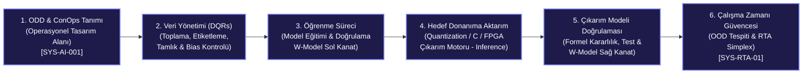

# 📘 Modül 7.1: Emniyet-Kritik Sistemlerde Yapay Zeka (AI), EASA Yol Haritası ve SOTIF (ISO 21448)

## 1. Neden Geleneksel DO-178C / ISO 26262 Yapay Zekayı Sertifiye Edemez?
Klasik emniyet standartları (**DO-178C, ISO 26262, IEC 61508**) şu temel varsayıma dayanır:
> *"Sistemin davranışı insan tarafından yazılmış açık gereksinimlere (HLR/LLR) indirgenebilir, her kod satırı bir gereksinime bağlanabilir ve MC/DC ile tüm mantıksal karar dalları test edilebilir."*

Derin Öğrenme (Deep Neural Networks - DNN) ve Makine Öğrenmesi (ML) modellerinde ise bu varsayım tamamen çöker:
1. **Gereksinim Yerine Veri (Data-Driven Behavior):** Bir Evrişimli Sinir Ağının (CNN) pisti veya yayayı nasıl tanıdığı `if-else` kurallarıyla değil, milyonlarca eğitim görüntüsünden öğrenilen milyonlarca kayan noktalı ağırlık ($W_{ij}$) ile kodlanmıştır.
2. **MC/DC Anlamsızlığı:** Bir sinir ağındaki ReLU aktivasyon fonksiyonlarının %100 çalışmış olması, ağın yeni bir hava koşulunda doğru karar vereceğini **asla kanıtlamaz**.
3. **Kırılganlık ve Çekişmeli Örnekler (Adversarial Perturbations):** Görüntüdeki birkaç pikselin insan gözünün fark edemeyeceği kadar ($\epsilon$) değişmesi veya kameraya yansıyan güneş parlaması, modelin bir uçağı/yayayı tamamen gözden kaçırmasına yol açabilir.
4. **Dağılım Dışı Veriler (Out-of-Distribution - OOD):** Eğitim veri setinde (Operational Design Domain - ODD) bulunmayan nadir bir durumla (Corner Case) karşılaşıldığında model yüksek güven skoruyla (Overconfidence) tamamen yanlış çıktı üretebilir.

---

## 2. EASA AI Roadmap 2.0 ve EUROCAE ED-324 / SAE G-34 (ARP6983)
Avrupa Havacılık Emniyeti Ajansı (**EASA Concept Paper: Guidance for Level 1 & 2 Machine Learning Applications**) ve **SAE G-34 / EUROCAE WG-114 (ARP6983)** komitesi, havacılıkta yapay zeka sertifikasyonu için **W-Şekilli Yaşam Döngüsü (W-Shaped Development Lifecycle)** modelini geliştirmiştir:

### EASA Yapay Zeka Güvenilirlik Yapıtaşları (7 Trustworthiness Building Blocks)
1. **Güvenilirlik Analizi & Etik (Trustworthiness Analysis)**
2. **Öğrenme Güvencesi (Learning Assurance - W-Model):** Veri Kalitesi Gereksinimleri (**DQR - Data Quality Requirements**: Tamlık, Temsiliyet, İzlenebilirlik) ve model genelleştirme yeteneğinin kanıtı.
3. **Açıklanabilirlik (AI Explainability):** Modelin kararının operatör ve mühendis tarafından anlaşılabilir olması (Saliency Maps, SHAP/LIME).
4. **Emniyet Risk Azaltımı (AI Safety Risk Mitigation):** Yapay zeka kutusunun dışına konan **Run-Time Assurance (RTA / Simplex)** emniyet zarfı monitörleri.
5. **İnsan-Yapay Zeka Ekip Çalışması (Human-AI Teaming - Seviye 1A/1B/2A/2B/3A/3B)**.

---

## 3. ISO 21448 SOTIF (Safety of the Intended Functionality)
Otomotiv ve otonom sistemlerde **ISO 26262**, sistemdeki *donanım arızaları veya yazılım bug'larından* kaynaklanan tehlikeleri inceler.  
Ancak **hiçbir donanım veya yazılım arızası olmadığı halde**, sensörlerin fiziksel limitleri (örn: yoğun kar yağışında LiDAR'ın kör olması) veya yapay zeka algoritmasının yetersizliği nedeniyle kaza meydana gelebilir. İşte bu alanı **ISO 21448 (SOTIF)** yönetir!

### SOTIF 4Senaryo Bölgesi Matrisi
| | **Bilinen Senaryolar (Known Scenarios)** | **Bilinmeyen Senaryolar (Unknown Scenarios)** |
| :--- | :---: | :---: |
| **Emniyetli Davranış (Safe)** | **Alan 1 (Bilinen & Emniyetli)** *Hedef: Bu alanı maksimize et* | **Alan 4 (Bilinmeyen & Emniyetli)** *Genelleme kapasitesi* |
| **Tehlikeli Davranış (Unsafe)** | **Alan 2 (Bilinen & Tehlikeli)** *Çözüm: Mimari modifikasyon, ODD kısıtlama veya RTA ile Alan 1'e taşı* | **Alan 3 (Bilinmeyen & Tehlikeli)** *Çözüm: Simülasyon, Fuzzing, Saha Testi ile keşfet ve Alan 3'ü < kabul edilebilir riske indir!* |

---

## 4. Çıkarım (Inference) Motorunun Deterministik Uygulama Kısıtları
Eğitim (Training) aşaması Python/PyTorch üzerinde GPU sunucularında yapılabilir; ancak uçakta veya araçta koşan **Çıkarım (Inference)** kodu DO-178C / DO-254 kurallarına tabidir:
- **Çevrimiçi Öğrenme Yasağı (No Online Learning in Flight):** Sertifiye edilen ağırlıklar uçuş sırasında güncellenemez; ağırlık matrisi salt-okunur (`const float`) bellekte dondurulur ve CRC ile korunur.
- **Sabit Zamanlı İcra (Constant Execution Time):** Sinir ağı katmanlarındaki matris çarpımları veri değerine bağlı dallanma içermemeli, WCET süresi tamamen sabit ve deterministik olmalıdır.
- **Niceleme (Quantization) Hatası Doğrulaması:** Eğitimdeki `FP32` ağırlıklar gömülü donanımda `INT8` veya `FP16`'ya dönüştürüldüyse, tüm doğrulama testleri hedef donanımdaki niceleme sonrası model üzerinde tekrarlanmalıdır.

---

## 5. İzlenebilirlik Zinciri
- Tehlike Kaydı: `[HAZ-AI-01]` Görsel tabanlı otonom iniş yapay zeka modelinin yoğun sis veya güneş parlaması (Out-of-Distribution girdi) altında pist merkez hattını yanlış tahmin etmesi.
- Sistem Gereksinimi: `[SYS-AI-001]` Yapay zeka tabanlı görsel seyrüsefer sistemi yalnızca tanımlı Operasyonel Tasarım Alanı (ODD: Görüş $> 1500\text{ m}$, Yan rüzgar $< 20\text{ kt}$) içinde yetkilendirilmeli ve çıktı belirsizliği (Epistemic Uncertainty) izlenmelidir.
- Üst Seviye Yazılım Gereksinimi: `[HLR-AI-010]` Çıkarım motoru her karede modelin güven skorunu ve giriş görüntüsü entropisini hesaplamalı; ODD dışı girdi tespit edildiğinde 20 ms içinde kontrolü deterministik INS/ILSEmniyet Kontrolcüsüne (`[SYS-RTA-01]`) devretmelidir.
- Alt Seviye Tasarım: `[LLR-AI-020]` `AI_VerifyWeightsCRC()` fonksiyonu her başlatmada ve arka plan döngüsünde Flash bellekteki sinir ağı ağırlık matrisinin CRC-32 sağlamasını doğrulamalıdır.
- Doğrulama Testi: `[UTEST-AI-030]` Sentetik sis, sensör gürültüsü ve çekişmeli (adversarial) bozulma eklenmiş test veri seti ile OOD dedektörünün %100 yakalama ve RTA geçiş testi.
