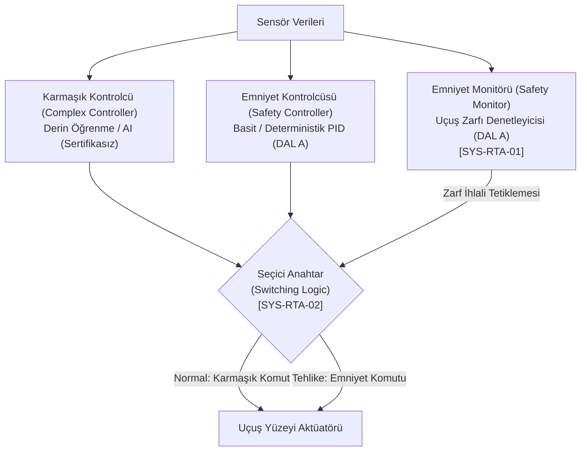

# 📘 Modül 7.2: Run-Time Assurance (RTA) ve Simplex Mimarisi (ASTM F3269)

## 1. Run-Time Assurance (RTA) Felsefesi
Sertifiye edilemeyen karmaşık bir algoritmanın (Yapay Zeka, Derin Takviyeli Öğrenme, COTS İşlemci) emniyet-kritik bir sisteme dahil edilmesinin yolu **Run-Time Assurance (Çalışma Zamanı Güvencesi)** mimarisidir.

> **Prensip:** Karmaşık yapay zeka modelinin kendisini değil; yapay zekanın ürettiği kararların emniyet sınırlarını (Safety Envelope) aşıp aşmadığını çalışma zamanında denetleyen basit, formel olarak kanıtlanmış bir monitör sertifiye edilir.

---

## 2. Simplex Mimarisi Blok Şeması (ASTM F3269-17)

---

## 3. Üç Temel Bileşen
1. **Complex Controller (CC):** Yüksek performanslı ancak formel kanıtı olmayan yapay zeka algoritması. Normal şartlarda aktüatörü yönetir.
2. **Safety Monitor (SM):** Sistemi matematiksel olarak modellenmiş "Emniyetli Durum Zarfı" içinde tutar. Eğer CC tehlikeli bir manevra komutu üretirse (örn: stall açısı ihlali), bunu mikro saniyeler içinde tespit eder.
3. **Safety / Recovery Controller (SC):** Sertifikalı, basit, deterministik (DAL A) kurtarma algoritmasıdır. Kontrolü devralıp hava aracını düz uçuş moduna getirir.

---

## 4. İzlenebilirlik İlişkisi
- `[SYS-RTA-01]` Emniyet monitörü hücum açısını (AoA) izlemeli ve 15 derecenin üzerine çıkarsa anahtarlamayı tetiklemelidir.
- `[LLR-RTA-010]` `RTA_CheckSafetyEnvelope()` fonksiyonu 5 ms periyotla zarf denetimi yapmalıdır.
