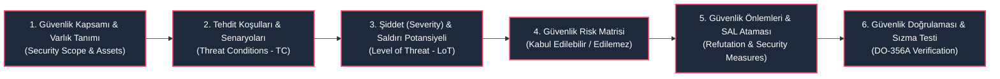

# 📘 Modül 9.1: Havacılıkta Siber Güvenlik ve Uçuşa Elverişlilik (DO-326A / ED-202A & DO-356A)

## 1. Giriş: Emniyet (Safety) ve Güvenlik (Security) Yakınsaması
Geleneksel havacılıkta aviyonik sistemler dış dünyadan tamamen izole, kapalı devre (`Air-Gapped`) mimariler olarak kabul edilirdi. Ancak modern hava araçlarında (B787, A350, Kaan, İHA/SİHA platformları) **E-Enabled Aircraft** konseptiyle birlikte IP tabanlı ağlar (AFDX), uydu haberleşmesi (SATCOM), kablosuz bakım arayüzleri ve COTS bileşenler kritik uçuş sistemleriyle aynı omurgayı paylaşmaktadır.

> **Temel Paradigma:**  
> - **Emniyet (Safety - ARP 4761A / DO-178C):** Sistemin *tesadüfi donanım arızalarına veya kasıtsız tasarım hatalarına* karşı insan hayatını ve çevreyi korumasıdır.  
> - **Siber Güvenlik (Security - DO-326A / ED-202A):** Sistemin *kasıtlı, kötü niyetli ve akıllı saldırganlara (Threat Actors)* karşı uçuşa elverişliliğini korumasıdır.  
> **Kural:** *"Güvenli (Secure) olmayan bir sistem, emniyetli (Safe) olamaz!"*

---

## 2. Havacılık Siber Güvenlik Standartları Ailesi (RTCA / EUROCAE)

FAA ve EASA, siber güvenliği uçuşa elverişlilik sertifikasyonunun ayrılmaz bir parçası haline getirmiştir:

| RTCA Standardı | EUROCAE Karşılığı | Standart Başlığı ve Kapsamı | ARP / DO Eşleniği |
| :--- | :--- | :--- | :--- |
| **DO-326A** | **ED-202A** | *Airworthiness Security Process Specification* (Üst seviye güvenlik yaşam döngüsü) | ARP 4754B |
| **DO-356A** | **ED-203A** | *Airworthiness Security Methods and Considerations* (Tehdit analizi ve doğrulama metotları) | ARP 4761A / DO-178C |
| **DO-355** | **ED-204** | *Information Security Guidance for Continuing Airworthiness* (Operasyonel ve bakım güvenliği) | Sürekli Uçuşa Elverişlilik |

---

## 3. DO-326A Güvenlik Risk Değerlendirme Süreci (Security Risk Assessment)

ARP 4761A'daki FHA (Fonksiyonel Tehlike Değerlendirmesi) sürecine paralel olarak DO-326A, **PSRA (Preliminary Security Risk Assessment)** ve **SSRA (System Security Risk Assessment)** süreçlerini işletir:

### Güvenlik Güvence Seviyeleri (SAL - Security Assurance Level)
DO-178C'deki **DAL (A–E)** seviyelerine benzer şekilde, bir güvenlik önleminin (Security Measure) ne kadar sıkı doğrulanacağını **SAL 0 – SAL 3** seviyeleri belirler:
- **SAL 3 (En Yüksek):** Catastrophic veya Hazardous tehdit koşullarını engelleyen birincil bariyerler (Örn: Uçuş kontrol ağı ile yolcu eğlence ağı arasındaki kriptografik ağ geçidi). Kaynak kod düzeyinde güvenlik incelemesi, formel doğrulama ve derin sızma testi (Penetration Testing) zorunludur.
- **SAL 2 (Orta-Yüksek):** Major tehdit koşullarını azaltan veya derinlemesine savunma (Defense-in-Depth) sağlayan ikincil katmanlar.
- **SAL 1 (Temel):** Minor etkileri önleyen standart güvenlik kontrolleri.

---

## 4. MILS (Multiple Independent Levels of Security) Mimarisi

Entegre Modüler Aviyonik (IMA - ARINC 653) sistemlerinde farklı güvenlik seviyelerindeki (Top Secret, Secret, Unclassified veya Flight-Critical vs. Open-World) partisyonların tek bir işlemci üzerinde çalışabilmesi için **Separation Kernel (Ayrıştırma Çekirdeği)** kullanılır.

### Bilgi Akış Kontrolü (NEAT Prensibi)
Bir MILS ayrıştırma çekirdeği ve güvenlik duvarı 4 temel özelliği kanıtlamalıdır:
1. **N - Non-bypassable (Atlatılamaz):** Hiçbir partisyon, donanımsal MMU/IOMMU ve çekirdek politikalarını bypass ederek doğrudan fiziksel belleğe veya DMA kanalına erişemez.
2. **E - Evaluatable (Değerlendirilebilir):** Çekirdek kodu o kadar küçük ve modüler olmalıdır ki (genellikle < 10.000 LOC), matematiksel/formel olarak doğrulanabilsin (Common Criteria EAL 6+ / EAL 7).
3. **A - Always Invoked (Her Zaman Devrede):** Her sistem çağrısı ve kesme (Interrupt) istisnasız güvenlik politikası denetiminden geçer.
4. **T - Tamper-proof (Kurcalanamaz):** Kod ve güvenlik politikası tablosu Salt-Okunur (ROM / Hardware Locked Flash) bellekte tutulur ve çalışma zamanında değiştirilemez.

---

## 5. Emniyet ve Güvenlik Çatışması (Safety vs. Security Trade-offs)
Emniyet ve güvenlik gereksinimleri bazen birbiriyle doğrudan çelişebilir. Sistem mimarı bu çatışmaları **Co-Engineering** ile çözmek zorundadır:

| Senaryo | Siber Güvenlik Yaklaşımı | Fonksiyonel Emniyet Yaklaşımı | Mühendislik Çözümü (Co-Engineering) |
| :--- | :--- | :--- | :--- |
| **Bozuk / Şüpheli Paket Tespiti** | Bağlantıyı derhal kes, oturumu kapat (Reset/Lockdown) | Bağlantıyı kesmek kontrol kaybına yol açar (Availability öncelikli) | Paketi reddet, bir önceki geçerli değeri tut (Last Valid Value) veya güvenli yedek kanala (Backup Bus) düş |
| **Kriptografik Doğrulama** | Ağır asimetrik şifreleme (RSA-4096) kullan | Yüksek işlem süresi WCET ve gecikme (Jitter) sınırını bozar | Donanım hızlandırmalı simetrik MAC (AES-GCM / CMAC) ile < 10 µs gecikmeli doğrulama yap |
| **Kablosuz Yazılım Güncelleme** | Anında yama (Hot-patching) ile zafiyeti kapat | Sertifikalı ikili kod (Binary) uçuşta asla değiştirilemez! | Güncellemeyi yalnızca uçak yerde (Weight-on-Wheels = TRUE) ve bakım anahtarı takılıyken kriptografik imzayla kabul et |

---

## 6. İzlenebilirlik Zinciri (DO-326A -> ARP 4754B -> DO-178C)
- Tehlike & Tehdit Kaydı: `[HAZ-SEC-01]` Yetkisiz bakım bilgisayarı veya yer istasyonu üzerinden uçuş kontrol veri yoluna sahte (spoofed) komut enjeksiyonu.
- Sistem Güvenlik Gereksinimi: `[SYS-SEC-101]` Uçuş kontrol bilgisayarı, yalnızca donanım tabanlı ağırlık-tekerlekte (Weight-on-Wheels) sinyali aktifken ve Ed25519 dijital imzası doğrulanmışsa yazılım yükleme moduna geçmelidir.
- Üst Seviye Yazılım Gereksinimi: `[HLR-SEC-201]` Bootloader, uygulama imajının SHA-256 özetini ve dijital imzasını doğrulamadan uygulama adresine dallanmamalıdır.
- Alt Seviye Tasarım Gereksinimi: `[LLR-SEC-301]` `SecBoot_VerifyImage()` fonksiyonu imza doğrulaması başarısız olduğunda `BOOT_AUTH_FAULT` bayrağını set etmeli ve sistemi güvenli kurtarma imajına (Golden Image) yönlendirmelidir.
- Doğrulama Testi: `[UTEST-SEC-401]` Bozuk imzalı (1-bit flipped signature) yazılım imajı ile negatif yükleme ve geri dönüş (fallback) testi.
