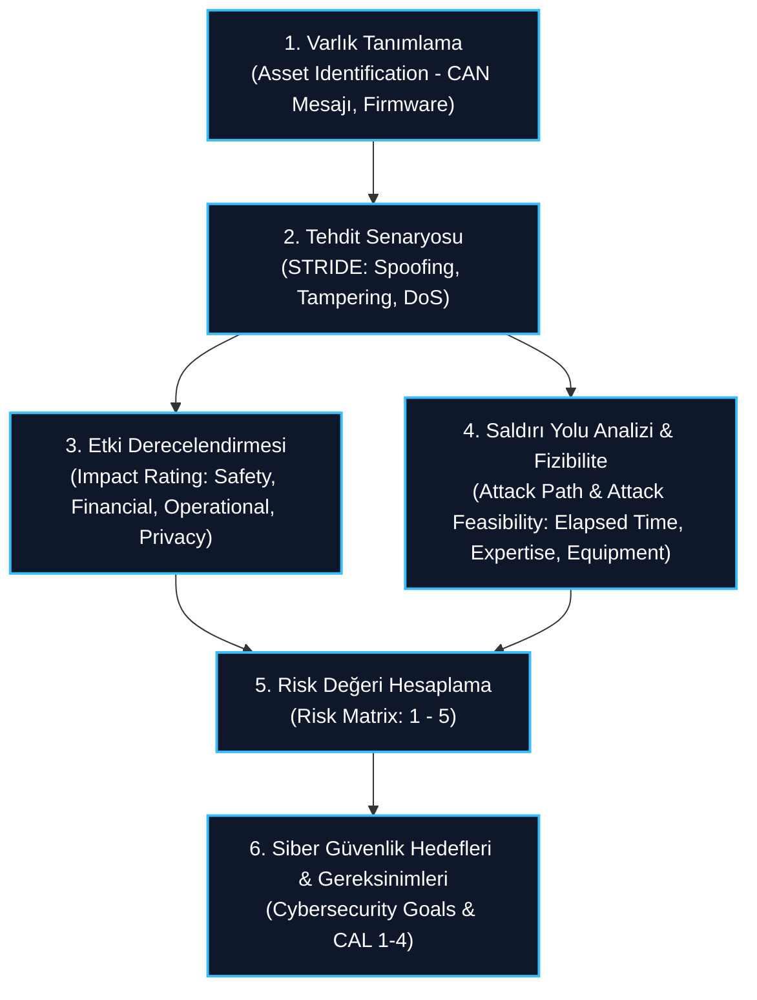
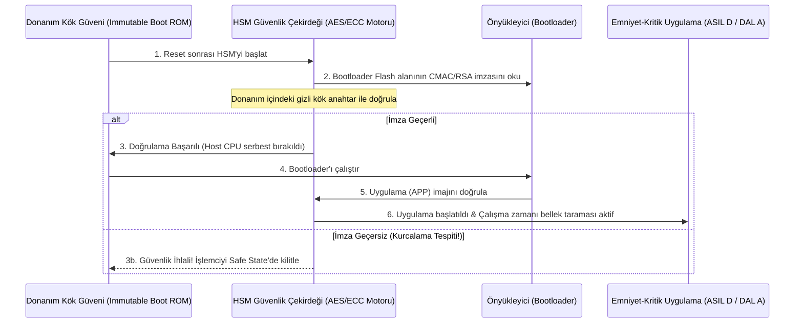

# 📘 Modül 9.2: Otomotiv Siber Güvenliği, TARA ve Donanım Güvenlik Modülleri (ISO/SAE 21434 & HSM)

## 1. ISO/SAE 21434 ve UNECE R155 Regülasyonu
Modern bağlantılı ve otonom araçlar (SDV - Software-Defined Vehicles); V2X, Bluetooth, Hücresel (5G), OBD-II ve OTA (Over-the-Air) arayüzleri üzerinden dış dünyaya açıktır. Bir saldırganın bilgi-eğlence (Infotainment) sisteminden sızıp CAN veri yolu üzerinden fren veya direksiyon ECU'suna (Electronic Control Unit) sahte mesaj göndermesi doğrudan **ASIL D seviyesinde ölümcül bir emniyet ihlalidir**.

- **ISO/SAE 21434:** Otomotiv elektrik/elektronik (E/E) sistemlerinin konsept aşamasından trafikten çekilmesine (Decommissioning) kadar siber güvenlik mühendisliği süreçlerini tanımlayan uluslararası standarttır.
- **UNECE R155:** Avrupa Birliği ve anlaşmalı ülkelerde yeni tip onayı alacak tüm araçlar için **CSMS (Cyber Security Management System)** sertifikasını yasal zorunluluk haline getirmiştir.

---

## 2. TARA (Threat Analysis and Risk Assessment) Metodolojisi
ISO 26262'deki **HARA (Hazard Analysis and Risk Assessment)** sürecinin siber güvenlikteki karşılığı **TARA**'dır:



### STRIDE Modeli ve Otomotiv Karşılıkları
| STRIDE Kategorisi | Güvenlik Özelliği | Otomotiv / Aviyonik Saldırı Örneği | Savunma Mekanizması |
| :--- | :--- | :--- | :--- |
| **S - Spoofing (Kimlik Sahteciliği)** | Kimlik Doğrulama (Authentication) | Arıza teşhis portundan sahte Direksiyon Açısı CAN mesajı basılması | AUTOSAR SecOC (CMAC Doğrulaması) |
| **T - Tampering (Kurcalama)** | Bütünlük (Integrity) | ECU Flash belleğindeki kalibrasyon haritasının değiştirilmesi | Secure Boot & HSM Dijital İmza |
| **R - Repudiation (İnkar)** | İnkar Edilemezlik (Non-repudiation) | Kritik parametre değişikliğini kimin yaptığının izlenememesi | Kriptografik Güvenlik Kayıt Defteri (Security Audit Log) |
| **I - Information Disclosure (İfşa)** | Gizlilik (Confidentiality) | JTAG/SWD portundan kriptografik anahtarların ve algoritmanın okunması | JTAG Sigorta Kilidi & HSM Key Store |
| **D - Denial of Service (Hizmet Reddi)** | Erişilebilirlik (Availability) | CAN hattına sürekli yüksek öncelikli (`ID: 0x000`) mesaj basılması | Donanımsal Bus Guardian & Rate Limiter |
| **E - Elevation of Privilege (Yetki Yükseltme)** | Yetkilendirme (Authorization) | Kullanıcı modundan çekirdek (Supervisor) moduna sıçrama | MPU/MMU Bellek Koruması & UDS `0x27` SecurityAccess |

---

## 3. AUTOSAR SecOC (Secure Onboard Communication)
Klasik CAN ve CAN-FD ağlarında mesajların hangi düğümden geldiğini kanıtlayan yerleşik bir kriptografik kimlik doğrulama yoktur. **AUTOSAR SecOC**, emniyet-kritik mesajlara gerçek zamanlı kriptografik doğrulama ekler:

```text
+-------------------+------------------------+---------------------------+
|   CAN-FD Başlığı  |   Kontrol Verisi       |   SecOC Güvenlik Alanı    |
|   (Arbitration)   |   (Hız, Tork, Fren)    |  [Fv (Tazelik)] + [MAC]   |
|      11/29-bit    |      4 - 48 Bayt       |   8-24 bit      24-64 bit |
+-------------------+------------------------+---------------------------+
```

1. **Freshness Value (Fv - Tazelik Sayacı):** Saldırganın daha önce kaydedilmiş geçerli bir fren mesajını tekrar ağa basmasını (**Replay Attack**) engellemek için her mesajda artan monotonik sayaç veya senkron zaman damgası kullanılır.
2. **MAC (Message Authentication Code - AES-128-CMAC):** Gönderici ECU; `Data ID + Payload + Tam Tazelik Sayacı` verisini gizli simetrik anahtarla (HSM içinde) imzalar ve kesilmiş (truncated) MAC etiketini mesaja ekler. Alıcı ECU, MAC doğrulanmazsa mesajı **kesinlikle işleme almaz**.

---

## 4. Donanım Güvenlik Modülü (HSM - Hardware Security Module) ve Güvenli Önyükleme (Secure Boot)

Yazılımsal kriptografi tek başına yetersizdir; çünkü anahtarlar normal RAM veya Flash bellekte durursa bellek dökümü (dump) ile çalınabilir. Bu nedenle modern emniyet işlemcilerinde (Örn: Infineon AURIX TC3xx/TC4xx, NXP S32G, Renesas RH850) ana işlemciden fiziksel güvenlik duvarıyla ayrılmış gömülü bir **HSM (EVITA Full / Medium)** çekirdeği bulunur.

### Güvenli Önyükleme Zinciri (Chain of Trust / Secure Boot)


---

## 5. İzlenebilirlik Zinciri
- Tehlike & Tehdit Kaydı: `[HAZ-CYB-02]` CAN-FD veri yolu üzerinde tekrar saldırısı (Replay Attack) ile otonom direksiyon aktüatörüne eski manevra komutunun enjekte edilmesi.
- Sistem Gereksinimi: `[SYS-CYB-105]` Tüm ASIL D şasi kontrol mesajları AUTOSAR SecOC Profil 1 (AES-128-CMAC ve 24-bit monotonik tazelik sayacı) ile korunmalıdır.
- Donanım Gereksinimi: `[HWR-HSM-015]` Kriptografik anahtarlar yalnızca EVITA-Full uyumlu HSM güvenli belleğinde saklanmalı, ana CPU tarafından doğrudan okunamamalıdır.
- Alt Seviye Yazılım Gereksinimi: `[LLR-CYB-210]` `SecOC_VerifyRxPdu()` fonksiyonu, gelen mesajın tazelik sayacı son kabul edilen değerden küçük veya eşitse `SECOC_E_REPLAY_DETECTED` hatası döndürmeli ve paketi düşürmelidir.
- Doğrulama Testi: `[HIL-CYB-305]` CANoe/Vector donanımı üzerinden kaydedilmiş geçerli direksiyon paketinin 50 ms sonra tekrar gönderilerek reddedildiğinin doğrulanması.
