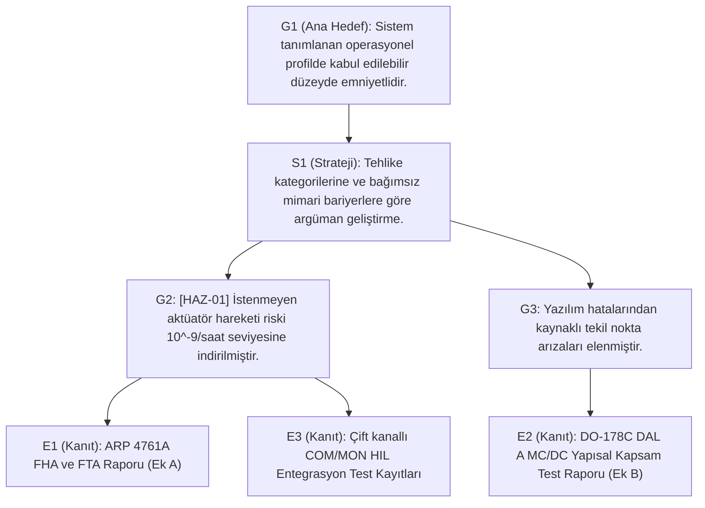

# 📋 Şablon: GSN (Goal Structuring Notation) Tabanlı Emniyet Dosyası (Safety Case)

## 1. Doküman Bilgileri
- **Proje Adı:** `[PROJE ADI]`
- **Sistem / LRU:** `[SİSTEM ADI]`
- **Güvence Seviyesi:** DO-178C DAL A / ISO 26262 ASIL D
- **Versiyon:** 1.0.0
- **Tarih:** 2026-11-16

---

## 2. GSN Emniyet İddia Hiyerarşisi

---

## 3. GSN Argüman Elemanları

### Hedefler (Goals):
- **`[G1]`**: Sistem tüm operasyonel fazlarda kaza olasılığını $10^{-9}$/saat sınırında tutar.
- **`[G2]`**: Uçuş kontrol bilgisayarı yazılımı hiçbir tanımsız davranış (Undefined Behavior) içermez.

### Çözümler ve Kanıtlar (Evidence / Solutions):
- **`[E1 - Statik Analiz]`**: MISRA C:2012 kural ihlali bulunmamaktadır (Polyspace / Coverity sıfır hata raporu).
- **`[E2 - Dinamik Kapsam]`**: %100 Statement, %100 Branch ve %100 MC/DC kapsamı elde edilmiştir.
- **`[E3 - İzlenebilirlik]`**: Çift yönlü RTM matrisi boşluksuz olarak tamamlanmıştır.
